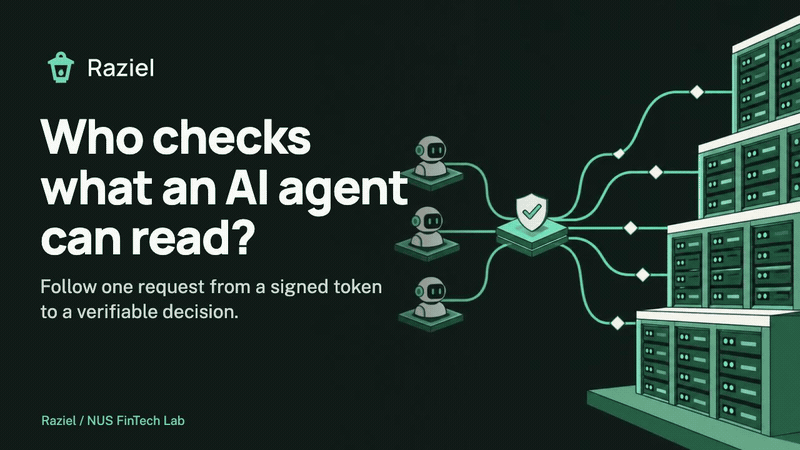
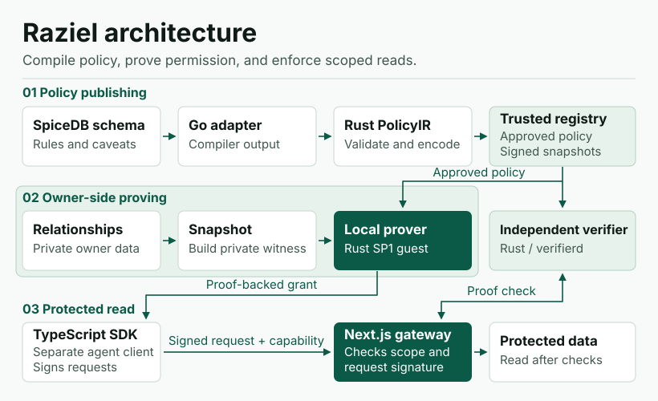
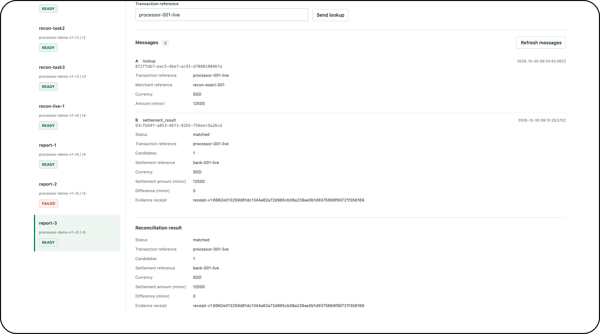
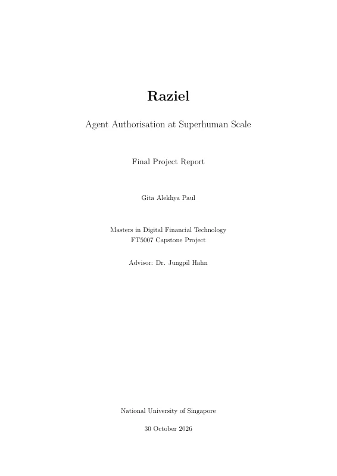
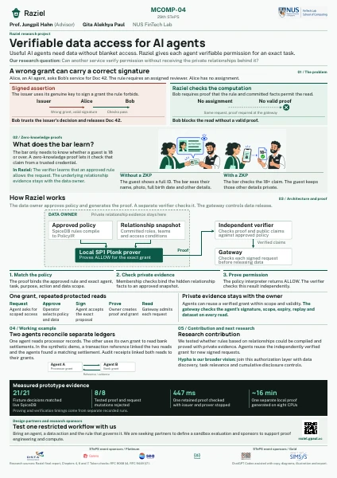
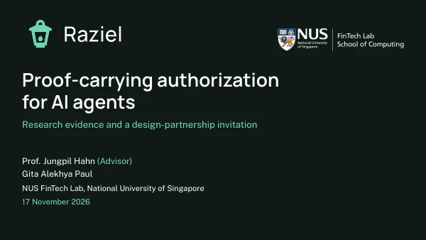

<p align="center">
  <a href="https://raziel.gpaul.cc/">
    <picture>
      <source media="(prefers-color-scheme: dark)" srcset="site/assets/brand/logo-primary-dark.svg">
      
    </picture>
  </a>
</p>

<h1 align="center">Proof-backed access for AI agents</h1>

<p align="center">
  Raziel lets a service verify an agent's permission for an exact task and data scope.
  The data owner keeps the private relationship evidence.
</p>

<p align="center">
  <strong><a href="https://raziel.gpaul.cc/#explainer">Watch the explainer</a></strong>
  · <a href="https://raziel.gpaul.cc/#demo">Watch the demo</a>
  · <a href="#research">Read the research</a>
  · <a href="docs/quickstart.md">Quickstart</a>
  · <a href="https://raziel.gpaul.cc/#partnerships">Discuss a pilot</a>
</p>

<p align="center">NUS FinTech Lab · Prof. Jungpil Hahn (Advisor) · Gita Alekhya Paul</p>

## Why trust is harder to scale for agents

A single task can send an agent across several services. Each service has to decide what the agent can read. If those calls rely on a wrong grant, they can repeat the same access mistake.

<a href="https://raziel.gpaul.cc/#explainer">
  <picture>
    <source media="(prefers-reduced-motion: reduce)" srcset="site/assets/explainer/raziel-trust-poster.webp">
    
  </picture>
</a>

[Play the 42-second explainer](https://raziel.gpaul.cc/#explainer) · [Open the MP4](https://raziel.gpaul.cc/assets/explainer/raziel-trust-explainer.mp4)

**A wrong grant can carry a correct signature.** Bob's service holds Doc 42. Its rule allows assigned reviewers to read it. Alice has no assignment. A legitimate issuer can still sign a grant that gives her access. In this example, Bob checks the OAuth access token's issuer, signature, audience, and expiry. Those checks pass, and Bob relies on the issuer to have applied the reviewer rule. [Signed access token validation](https://www.rfc-editor.org/rfc/rfc9068.html#section-4)

With Raziel, Bob's service requires proof that the approved policy and committed relationships permit the exact grant. Alice has no assignment, so the gateway withholds the file.

## How Raziel checks a grant



1. The data owner approves the policy. Raziel compiles supported SpiceDB rules into PolicyIR and commits to a snapshot of the relationships.
2. The prover generates a zero-knowledge proof that the approved rule permits the grant. The grant binds the agent's key, task, purpose, action, resource scope, and expiry.
3. An independent verifier checks the proof against the approved policy and authenticated snapshot records. The agent can reuse the verified grant within scope. The gateway still checks each signed request.

<details>
  <summary><strong>What stays private? An age-check analogy</strong></summary>
  <p>Showing a full ID at a bar reveals a name, photograph, and date of birth. An age proof lets the bar verify “18 or over” from a trusted credential. With Raziel, the verifier can check the permission proof, and the owner keeps the private relationship evidence.</p>
  
</details>

## Two agents, two ledgers

The payment agent reads synthetic processor records. The settlement agent uses a separate grant to look up the corresponding bank record. They share a settlement result and a receipt reference. Each agent keeps its own data access.

<a href="https://raziel.gpaul.cc/#demo"></a>

[Play the 2:35 reconciliation demo](https://raziel.gpaul.cc/#demo) · [Open the original MP4](https://raziel.gpaul.cc/assets/demo/raziel-walkthrough.mp4)

| Measured result | What we checked |
| --- | --- |
| **447 ms** | One isolated proof check with the issuer and prover stopped. [Retained proof run](https://github.com/gitaalekhyapaul/hypha-backend/blob/47661695cad950dd3683d74709f5875f9ae76019/docs/benchmarks/sp1-verifier/verifier-20260825T192214Z-34749.md) |
| **About 16 minutes** | One local PLONK proof in a separate service run. [Issuance run](https://github.com/gitaalekhyapaul/hypha-backend/blob/47661695cad950dd3683d74709f5875f9ae76019/docs/benchmarks/m4-service-flow/m4-service-20260826T090300Z-199729.md) |
| **8 of 8** | Tampered proof and request inputs rejected. [Mutation results](https://github.com/gitaalekhyapaul/hypha-backend/blob/47661695cad950dd3683d74709f5875f9ae76019/docs/benchmarks/sp1-verifier/verifier-20260825T192214Z-34749.md) |
| **21 of 21** | Fixture decisions matched between SpiceDB and the Rust evaluator. [Policy equivalence suite](https://github.com/gitaalekhyapaul/hypha-backend/blob/47661695cad950dd3683d74709f5875f9ae76019/docs/agent/history/B-0006-spicedb-policy-ir-equivalence.md) |

## Research

| Final report | A1 research poster | Partner and sponsor deck |
| :---: | :---: | :---: |
| [](https://raziel.gpaul.cc/assets/research/raziel-final-report.pdf) | [](https://raziel.gpaul.cc/assets/research/raziel-research-poster-a1.pdf) | [](https://raziel.gpaul.cc/assets/research/raziel-partner-research-deck.pdf) |
| [Read the public PDF](https://raziel.gpaul.cc/assets/research/raziel-final-report.pdf) | [Open the poster PDF](https://raziel.gpaul.cc/assets/research/raziel-research-poster-a1.pdf) | [Open the deck PDF](https://raziel.gpaul.cc/assets/research/raziel-partner-research-deck.pdf) |

The report covers the design, experiments, related research, and open questions. The public PDF omits the university ID from the title page.

## Repositories and quickstart

```sh
git clone --recurse-submodules https://github.com/gitaalekhyapaul/raziel.git
cd raziel
```

| Repository | Owns |
| --- | --- |
| [Hypha backend](https://github.com/gitaalekhyapaul/hypha-backend#readme) · `components/backend` | Policy compilation, proof generation, independent verification, operator console, and protected data gateway |
| [Raziel TypeScript SDK](https://github.com/gitaalekhyapaul/raziel-sdk-ts#readme) · `components/sdk` | Request signing, capability lifecycle, and signed reads. The [published package](https://www.npmjs.com/package/@gitaalekhyapaul/raziel-sdk-ts/v/0.1.0) is version 0.1.0. |
| [Raziel demo agents](https://github.com/gitaalekhyapaul/raziel-demo-agents#readme) · `components/demo-agents` | Two separately scoped reconciliation agents, their dashboards, and task messages |
| [Final report source](https://github.com/gitaalekhyapaul/raziel-final-report#readme) · private repo | LaTeX report, build instructions, research figures, and evaluator presentation source |
| This repository | [Public showcase](https://raziel.gpaul.cc/), [Remotion explainer source](video/README.md), and pinned component references |

The recursive clone checks out the backend, SDK, and demo agents at the commits pinned here. Use the [quickstart](docs/quickstart.md) to try the SDK or open the recorded operator walkthrough.

## Work with us

We're looking for teams with a workflow where agents need scoped access to sensitive data. Bring one restricted action and the rule that governs it. We can define a sandbox evaluation together. Research sponsors can support evaluation compute, proof engineering, or specialist review. [Discuss a pilot or sponsorship](https://raziel.gpaul.cc/#partnerships)

Raziel is the authorization foundation for **Hypha**, our broader research into data discovery, task relevance, and disclosure controls.

[29th STePS project listing](https://uvents.nus.edu.sg/event/29th-steps/module/MComp/project/4) · [Contributing](CONTRIBUTING.md) · [MIT license](LICENSE)
