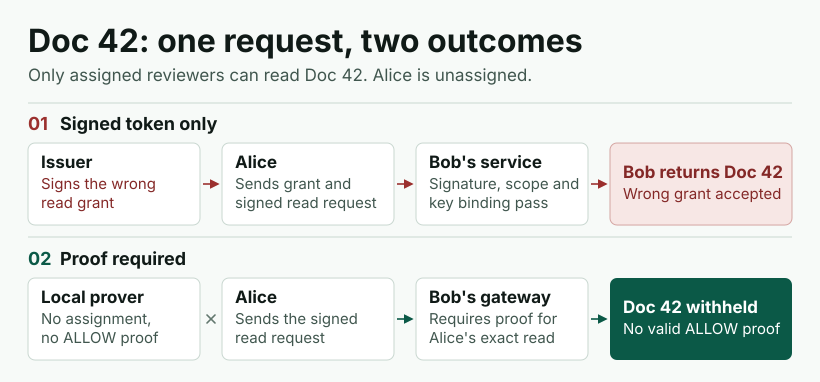
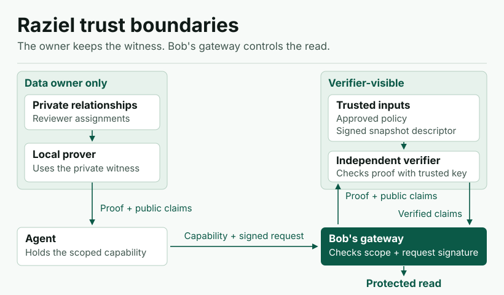
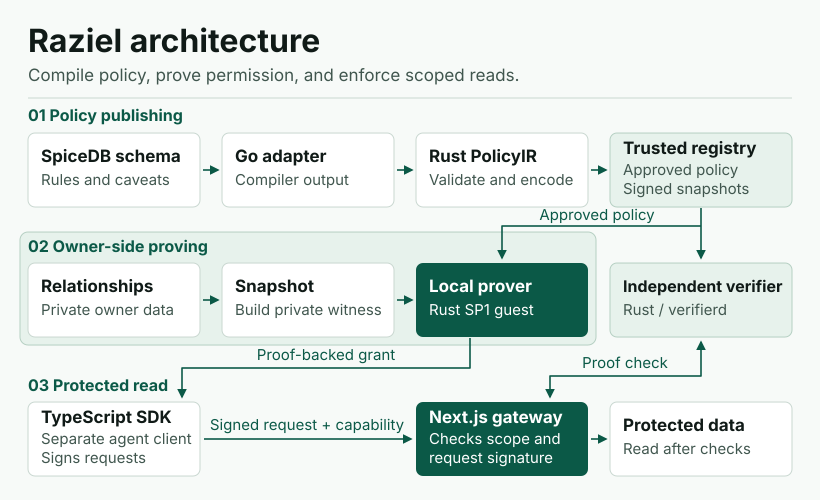
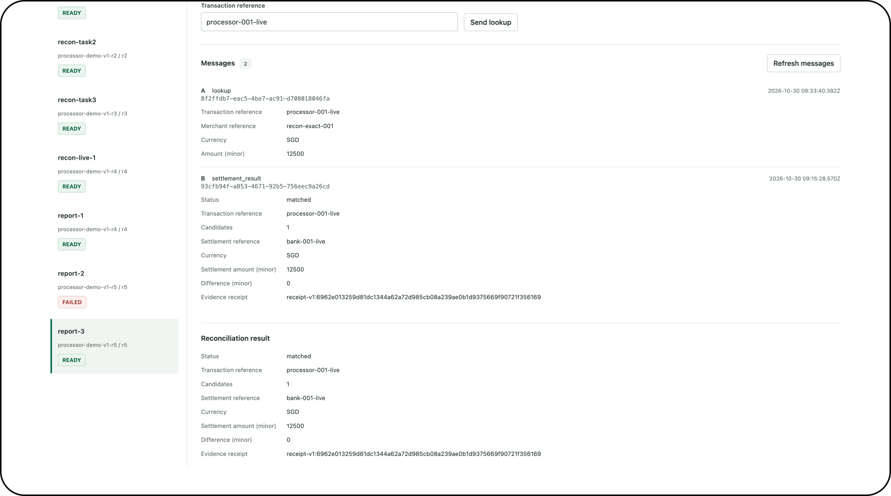

<picture>
  <source media="(prefers-color-scheme: dark)" srcset="site/assets/brand/logo-primary-dark.svg">
  
</picture>

# Raziel: Agent Authorisation at Superhuman Scale

We built Raziel to give AI agents proof-backed access to the data they need for a task. A service can check that a grant follows an approved rule, and the data owner keeps the private relationships that justify it.

**[Explore the project and discuss a pilot](https://raziel.gpaul.cc)** · **[Demo](#two-agents-two-ledgers)** · **[Quickstart](docs/quickstart.md)** · **[Vote MCOMP-04 at 29th STePS](https://uvents.nus.edu.sg/event/29th-steps/vote)**

## A task is not a grant

Alice, an AI agent, is asked to review a project. Bob's service holds Doc 42 and restricts it to assigned reviewers. A signed token lets Bob check who issued a grant. In a system that accepts the issuer's access decision, a correctly signed but wrongly issued grant can still pass the token checks. Raziel requires proof that Alice's read meets the approved rule.



## What crosses the trust boundary

The data owner holds the relationship evidence, such as team membership, and commits to a snapshot of it. The prover produces evidence of a successful authorisation check. An independent verifier checks the proof against trusted policy and snapshot records without contacting the issuer or receiving the private relationships. The gateway checks the agent's signature, grant scope, and validity before release.



## How we built it

The Go compiler adapter reads supported SpiceDB rules. Rust compiles them into PolicyIR, which a fixed SP1 program evaluates against the committed relationships. A successful evaluation can produce a local zero-knowledge proof. The capability binds the agent, task, purpose, and data scope. Agents use the TypeScript SDK to request access and reuse an issued grant for fresh signed reads within its scope.



## Two agents, two ledgers

The payment agent reads synthetic processor records. The settlement agent uses a separate grant to look up the corresponding bank record. They share a settlement result and a reference to its audit receipt. Each agent keeps its own data access.



| Measured result | What we checked |
| --- | --- |
| **447 ms** | One isolated proof check with the issuer and prover stopped. [Retained proof run](https://github.com/gitaalekhyapaul/hypha-backend/blob/47661695cad950dd3683d74709f5875f9ae76019/docs/benchmarks/sp1-verifier/verifier-20260825T192214Z-34749.md) |
| **About 16 min** | One local PLONK proof generated in a separate service run. [Issuance run](https://github.com/gitaalekhyapaul/hypha-backend/blob/47661695cad950dd3683d74709f5875f9ae76019/docs/benchmarks/m4-service-flow/m4-service-20260826T090300Z-199729.md) |
| **8/8** | Tampered proof and request inputs rejected. [Mutation results](https://github.com/gitaalekhyapaul/hypha-backend/blob/47661695cad950dd3683d74709f5875f9ae76019/docs/benchmarks/sp1-verifier/verifier-20260825T192214Z-34749.md) |
| **21/21** | Fixture decisions matched between SpiceDB and the Rust evaluator. [Policy equivalence suite](https://github.com/gitaalekhyapaul/hypha-backend/blob/47661695cad950dd3683d74709f5875f9ae76019/docs/agent/history/B-0006-spicedb-policy-ir-equivalence.md) |

## Get started

```sh
git clone --recurse-submodules https://github.com/gitaalekhyapaul/raziel.git
cd raziel
```

The component references pin the source versions and preserve their independent release histories.

| Component | What you will find |
| --- | --- |
| [Backend](https://github.com/gitaalekhyapaul/hypha-backend) · `components/backend` | Policy compiler, guest, prover, independent verifier, operator console, and protected-data gateway |
| [TypeScript SDK](https://github.com/gitaalekhyapaul/raziel-sdk-ts) · `components/sdk` | Agent identity binding, signed requests, and the public npm package |
| [Demo agents](https://github.com/gitaalekhyapaul/raziel-demo-agents) · `components/demo-agents` | Two agents, their consoles, and the synthetic reconciliation workflow |
| `site/` | The static project showcase. [Preview and deployment guide](docs/deployment.md) |

See the [quickstart](docs/quickstart.md) for setup paths and prerequisites. To propose a change, see [contributing](CONTRIBUTING.md). The source code is [MIT-licensed](LICENSE).

## Work with us

Raziel is the authorisation foundation for **Hypha**, our broader research into data discovery, task relevance, and disclosure controls. At NUS FinTech Lab, we're looking for workflows where agents need to collaborate across teams with scoped access to sensitive data. [Bring us a workflow you'd like to pilot](https://raziel.gpaul.cc/#partnerships).

**At 29th STePS:** [Open official voting](https://uvents.nus.edu.sg/event/29th-steps/vote), select **MComp**, then **Raziel (MCOMP-04)**.
